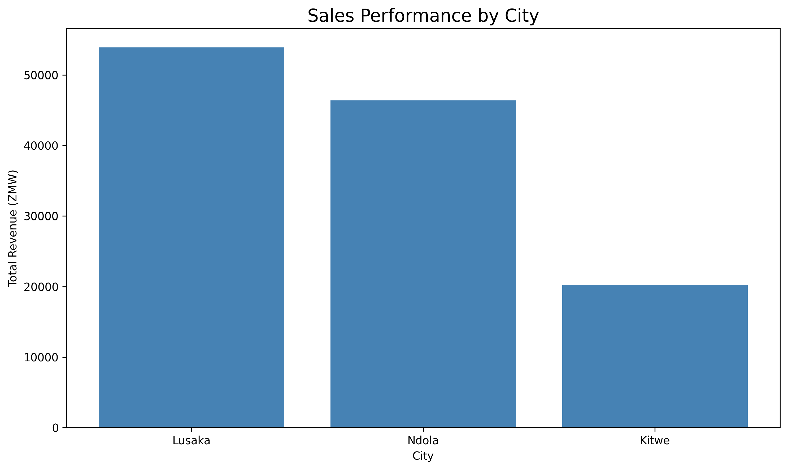
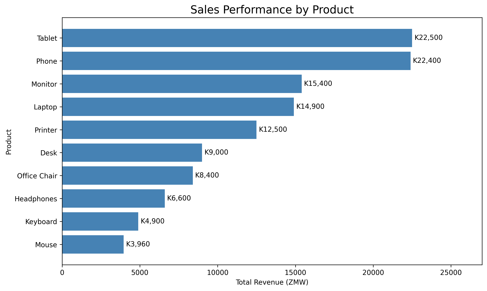
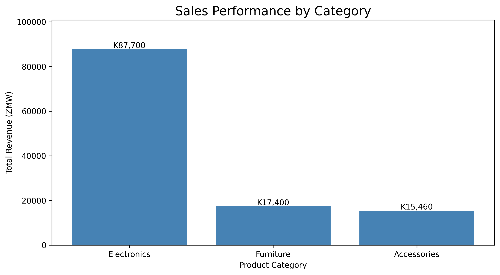
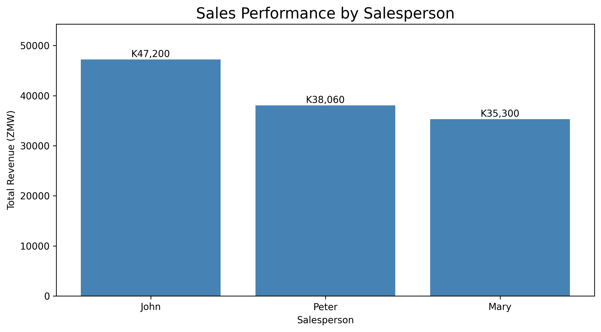
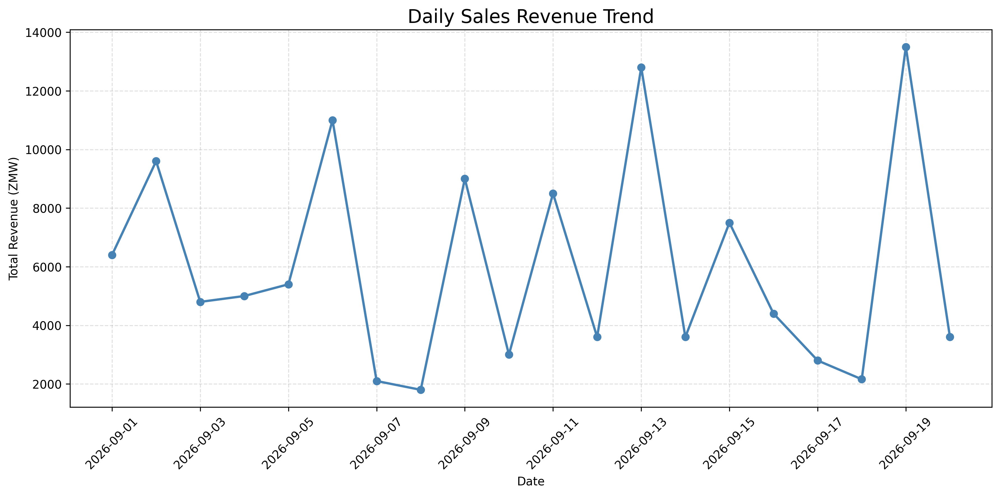

# Python Sales Data Analysis Project

## Project Overview

This project demonstrates how Python can be used to clean, analyze, and visualize business sales data.

The analysis was performed using Python, Pandas, and Matplotlib in Google Colab.

The objective was to identify sales trends, evaluate business performance, and generate insights to support business decision-making.

## Tools and Technologies

- Python
- Pandas
- Matplotlib
- Google Colab
- Microsoft Excel
- CSV

## Dataset Description

The dataset contains 20 valid sales transactions recorded in September 2026.

The dataset includes the following columns:

- Order ID
- Date
- Product
- Category
- City
- Salesperson
- Quantity
- Unit Price
- Total Sales

## Data Cleaning

The following data cleaning operations were performed:

1. Imported the Excel dataset using Pandas.
2. Identified blank rows and summary records.
3. Removed non-transaction rows.
4. Selected valid transaction records using Order IDs.
5. Verified the cleaned dataset against the original Excel dashboard.
6. Exported the cleaned dataset into CSV format.

## Key Performance Indicators

| KPI | Result |
|---|---|
| Total Revenue | K120,560 |
| Total Orders | 20 |
| Average Sale | K6,028 |
| Highest Sale | K13,500 |
| Lowest Sale | K1,800 |

## Business Insights

**Sales by Category**

- Electronics generated K87,700, representing approximately 72.7% of total revenue.
- Furniture generated K17,400.
- Accessories generated K15,460.

**Salesperson Performance**

- John generated K47,200.
- Peter generated K38,060.
- Mary generated K35,300.

**Product Performance**

- Tablets generated K22,500.
- Phones generated K22,400.
- Monitors generated K15,400.

## Data Visualizations

### Sales by City

### Sales by Product

### Sales by Category

### Salesperson Performance

### Daily Sales Trend

## Skills Demonstrated

- Python programming
- Data cleaning and validation
- Data manipulation using Pandas
- Filtering and grouping records
- Business KPI calculations
- Data visualization using Matplotlib
- Sales performance analysis
- Data interpretation and reporting
- Exporting datasets to CSV

## Conclusion

This project demonstrates practical Python data analysis skills, from importing and cleaning Excel data to calculating business performance metrics and presenting findings through visualizations.

## Author

**Bester Malama**

Aspiring Data Analyst

Lusaka, Zambia

GitHub: https://github.com/bestermalam
